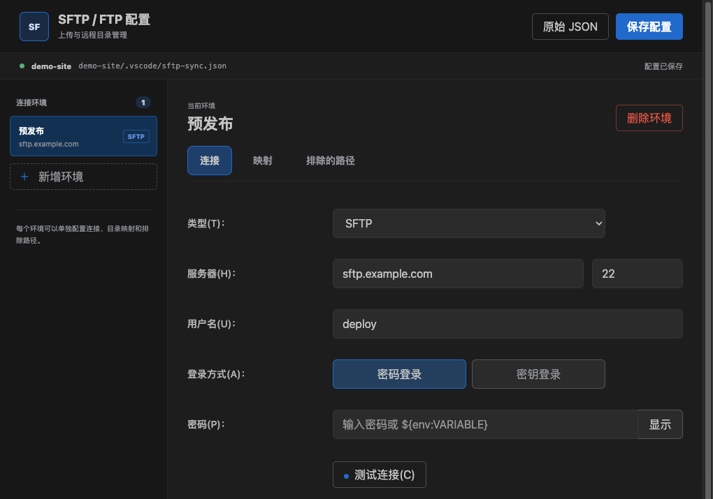
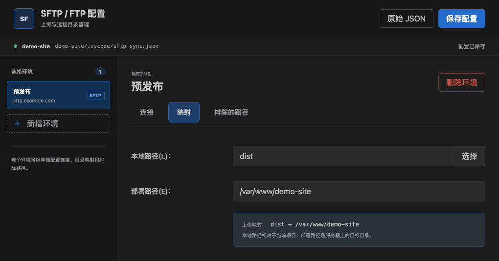
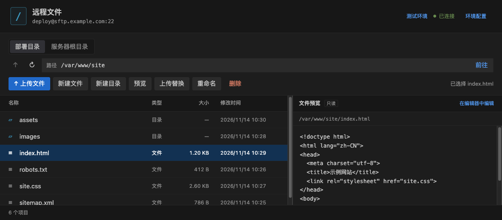

# SFTP / FTP Uploader

在 VS Code 中上传项目文件、管理远程目录和使用 SSH 终端。支持 SFTP、FTP 和 FTPS，可为测试和生产分别保存连接环境。

*以下截图使用示例连接。*

## 连接与目录映射

每个环境独立配置服务器、登录方式和部署目录。SFTP 支持密码和私钥登录，也可按环境设置排除规则和保存时自动上传。

## 文件上传

传输控制面板支持上传整个映射目录或当前文件。资源管理器也支持上传选中的文件和目录。

## 远程文件

在部署目录和服务器根目录之间切换，浏览、预览、上传、替换和删除文件。部署目录支持新建、重命名和直接编辑。

## SSH 终端

SSH 会话在编辑区独立打开。会话底部的「快捷命令」内置 12 条 Linux 查看命令，也支持保存常用命令到工作区。

