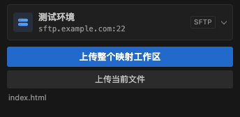
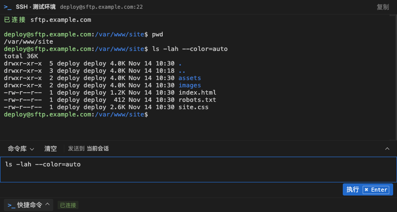

# SFTP / FTP Uploader

在 VS Code 里上传工作区文件、管理服务器目录和打开 SSH 终端。支持 SFTP、FTP、显式 FTPS 和隐式 FTPS。可以为测试和生产分别保存连接，切换环境时直接使用对应的服务器和部署目录。

## 安装与首次连接

1. 在 VS Code 的「扩展」里搜索 **SFTP / FTP Uploader**，选择发布者为 `ruiange` 的扩展。已有安装包时，在命令面板运行「扩展：从 VSIX 安装」，选择 `.vsix` 文件。
2. 打开要上传的本地项目文件夹。按 `F1` 打开命令面板，运行 `SFTP / FTP: 初始化配置`。
3. 在配置页填写协议、服务器地址、端口和登录方式。切到「映射」填写本地路径和部署路径，再点击「保存配置」和「测试连接」。
4. 从 VS Code 左侧打开 **SFTP / FTP**。在「传输控制」里确认当前环境，再选择要上传的范围。

## 上传文件



*截图使用示例连接。*

- **上传整个映射工作区**会上传当前环境映射的本地目录。例如本地路径是 `dist`、部署路径是 `/var/www/site`，则 `dist/assets/app.js` 会上传到 `/var/www/site/assets/app.js`。需要从项目根目录上传时，把本地路径设为 `.`。
- **上传当前文件**上传编辑器中打开的本地文件。也可在资源管理器中选中文件或目录，右键选择「SFTP / FTP → 上传文件或目录」。
- **切换环境**时，点击「传输控制」上的环境卡片，或点击状态栏的环境名称。悬停在环境卡片上可以查看路径映射。
- **保存时自动上传**可在配置页的「连接」里开启。部署前如需排除文件，可在「排除的路径」里填写规则。

手动上传可从进度通知取消。「传输控制」会显示排队、上传和结果。可从标题栏「⋯」打开连接测试或上传日志。

## 管理远程文件

点击左侧 **SFTP / FTP → 远程文件 → 打开远程文件管理器**。双击目录进入，双击文件预览。

| 浏览范围 | 可以做什么 |
| --- | --- |
| 部署目录 | 从配置中的部署路径开始。可新建、重命名，以及在 VS Code 中编辑并保存普通文件。 |
| 服务器根目录 | 从账号有权限访问的 `/` 开始，可以浏览部署目录之外的文件。在编辑器中打开文件时为只读。 |

两个范围都可以上传、替换或删除文件。覆盖和删除前请核对确认框中的目标路径。删除目录会一并删除其中的内容，当前范围的根目录受保护。预览和编辑支持 2 MB 以内的普通文件。

## SSH 终端与快捷命令

1. 在左侧 **SFTP / FTP → SSH 终端** 点选一个 SFTP 环境。每个会话在编辑区独立打开。首次连接时，请核对服务器指纹后再确认。
2. 点击该会话底栏的 **快捷命令**，展开终端下方的输入区。命令面板中的 `SFTP / FTP: SSH 快捷命令` 也能打开它。
3. 打开「命令库」并点选一条，命令会填入输入框。可以直接编辑，或用「保存当前命令」存到该工作区。
4. 等终端回到 Shell 提示符后，点击「执行」。也可以用 macOS 的 `⌘Enter` 或 Windows、Linux 的 `Ctrl+Enter` 发送。命令发往当前标签页的 SSH 会话。

命令发送成功后，输入框自动清空，终端继续显示执行结果。发送失败时，输入内容会保留。



*截图使用示例连接。*

命令库内置 12 条 Linux 查看命令，包括 `ls -lah --color=auto`、`df -h`、`free -h`、`ip -br addr` 和系统日志查询。服务和日志命令适用于使用 systemd 的服务器。多行命令需要目标 Shell 启用括号粘贴模式。

服务器列表显示 SSH 端口的 TCP 建连时间。终端保留远端的 ANSI 颜色，并为常见 Shell 提示符和日志级别加色。若习惯远端原有配色，可在设置中关闭 `sftpFtpUploader.colorizeSshLogs`。

## 连接配置参考

配置默认保存在工作区的 `.vscode/sftp-sync.json`，可在配置页点「原始 JSON」打开。新增、修改或删除环境后，点击「保存配置」生效。

- **SFTP** 默认端口为 22。可选密码登录或私钥登录。只有私钥设置了口令时才需要填写口令。
- **FTP / FTPS** 用密码登录。普通 FTP 和显式 FTPS 默认端口为 21，隐式 FTPS 默认端口为 990。FTPS 默认校验证书。
- **排除规则**相对于本地映射目录。全局规则对所有环境生效，也可针对单个环境补充规则。可用 `!路径` 重新包含被前面规则排除的文件。默认会跳过版本控制目录、`node_modules` 和符号链接。

下面是一个 SFTP 密码登录示例。请将地址、用户名和目录换成自己的配置。

```json
{
  "defaultProfile": "test",
  "profiles": {
    "test": {
      "protocol": "sftp",
      "host": "sftp.example.com",
      "port": 22,
      "username": "deploy",
      "authType": "password",
      "password": "${env:SFTP_PASSWORD}",
      "localPath": "dist",
      "remotePath": "/var/www/site",
      "uploadOnSave": false
    }
  }
}
```

密码和私钥口令可以用 `${env:变量名}` 引用环境变量。避免将真实密码、私钥或含凭据的连接配置提交到仓库。
